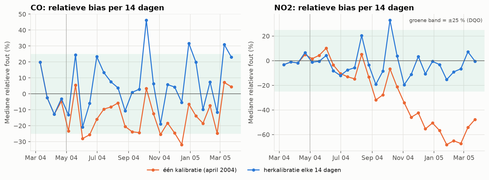
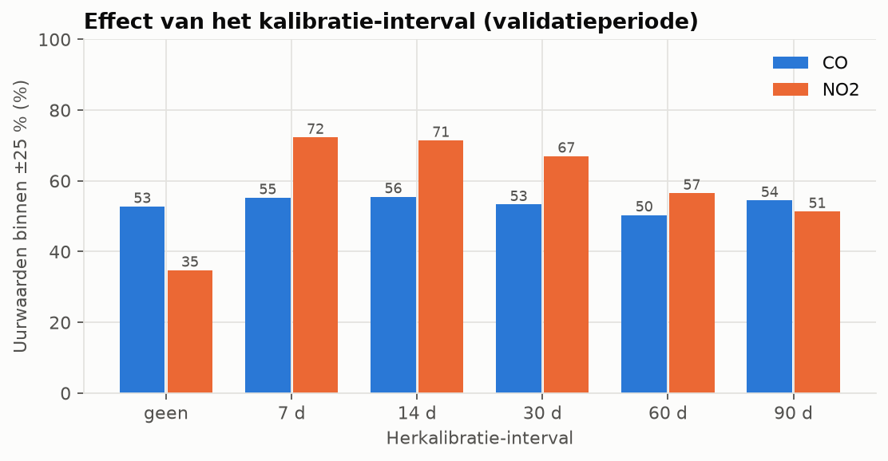
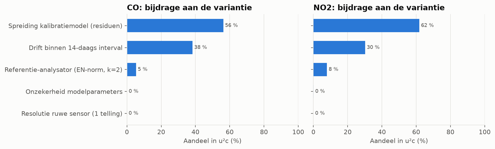
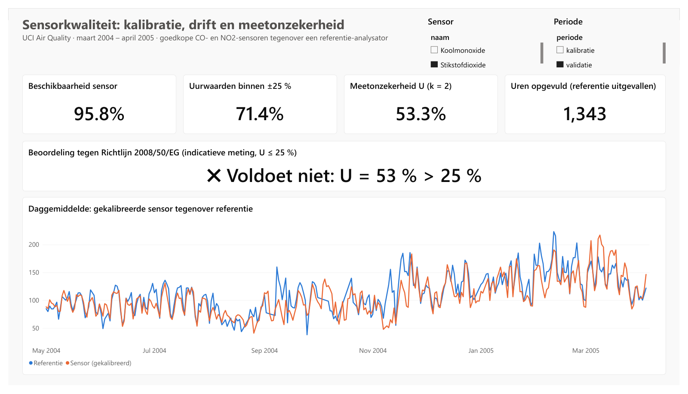
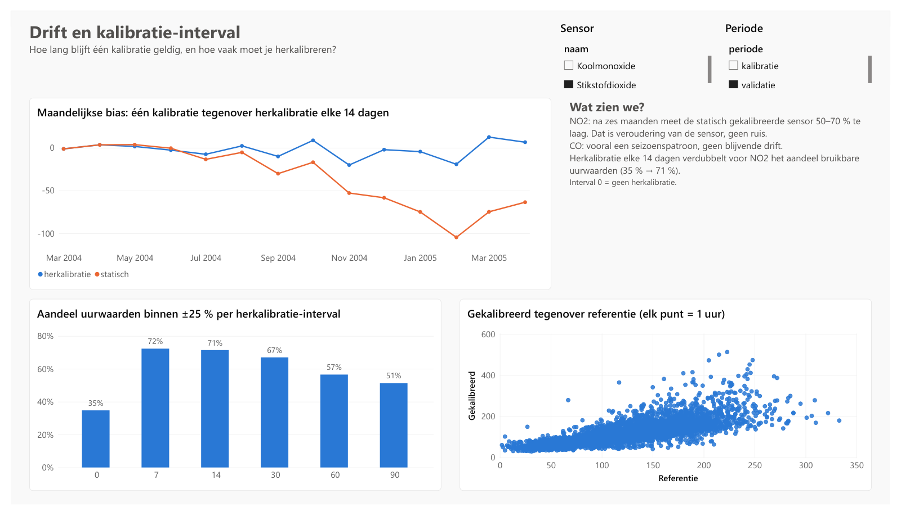
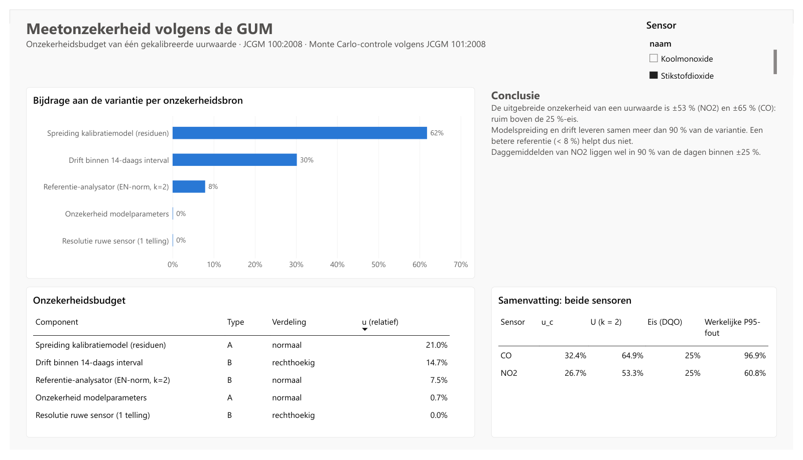
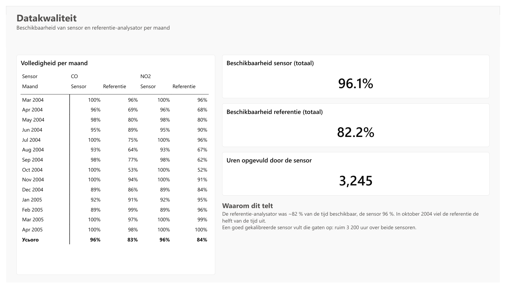

# Kalibratie, drift en meetonzekerheid van goedkope gassensoren

*Metrologie × data-analyse: van ruwe sensorsignalen naar een gevalideerd onzekerheidsbudget en een Power BI-rapport.*

**Tools:** Python (pandas, NumPy, matplotlib) · GUM (JCGM 100) · Monte Carlo (JCGM 101) · Power BI (Power Query, DAX)

---

## De vraag

Goedkope gassensoren kosten een fractie van een referentie-analysator. Maar hoe betrouwbaar zijn ze?
Dit project beantwoordt drie vragen die een meetverantwoordelijke of kwaliteitsmanager zou stellen:

1. **Kalibratie:** welk model zet het ruwe sensorsignaal het best om naar een concentratie?
2. **Drift:** hoe lang blijft een kalibratie geldig, en hoe vaak moet je opnieuw kalibreren?
3. **Meetonzekerheid:** voldoen de gekalibreerde waarden aan de Europese kwaliteitseis voor indicatieve metingen
   (U ≤ 25 %, Richtlijn 2008/50/EG)?

## De data

[UCI Air Quality](https://archive.ics.uci.edu/dataset/360/air+quality): 9 357 uurwaarden (maart 2004 – april 2005)
van een metaaloxide-sensorarray die naast een gecertificeerd referentiestation stond, in een Italiaanse stad.
Geanalyseerde kanalen: **CO** (koolmonoxide) en **NO2** (stikstofdioxide).

## Belangrijkste resultaten

| | CO | NO2 |
|---|---|---|
| Beste kalibratiemodel | log-log, alleen sensor | log-log + temperatuur & vocht |
| Uurwaarden binnen ±25 % zonder herkalibratie | 53 % | 35 % |
| Uurwaarden binnen ±25 % met herkalibratie elke 14 dagen | 56 % | **71 %** |
| Uitgebreide onzekerheid uurwaarde (k = 2) | ±65 % | ±53 % |
| Daggemiddelden binnen ±25 % | 65 % | **90 %** |



**Wat dit betekent:**

- **De NO2-sensor drift sterk.** Na zes maanden meet hij 50–70 % te laag. Herkalibratie elke 14 dagen houdt de bias binnen ±25 %
  en verdubbelt het aandeel bruikbare data.
- **Een omgevingscorrectie is geen automatische verbetering.** Voor NO2 is ze nodig (kruisgevoeligheid voor vocht),
  voor CO verslechtert ze de validatie door overfitting op voorjaarscondities.
- **Uurwaarden halen de 25 %-norm niet, daggemiddelden van NO2 wel.** Geschikt dus voor trends, hotspots en het opvullen
  van ontbrekende referentiedata. Deze sensor vervangt het referentiestation niet.
- **Het onzekerheidsbudget wijst aan waar je moet ingrijpen:** de modelspreiding (56–62 %) en de drift (30–38 %).
  De referentie zelf levert minder dan 8 % van de variantie, dus een duurdere referentie helpt niet.
- **Het budget is empirisch gevalideerd.** Voor NO2 klopt het (P95-fout 61 % tegenover 55 % voorspeld). Voor CO
  onderschat het de fout bij lage concentraties: de relatieve onzekerheid is daar concentratie-afhankelijk.




## Power BI-rapport

Vier pagina's: overzicht met KPI's, drift en kalibratie-interval, meetonzekerheid en datakwaliteit.
Het rapport werkt met een sterschema (dimensietabel voor sensoren, feitentabellen voor metingen en kwaliteit),
laadt de data via Power Query met een padparameter en een vaste locale, en berekent de KPI's met DAX-measures.
Details: [powerbi/README.md](powerbi/README.md) · volledig rapport als PDF: [Sensorkwaliteit.pdf](powerbi/Sensorkwaliteit.pdf)



<details>
<summary>Overige pagina's</summary>





</details>

## Aanpak

| Stap | Methode |
|---|---|
| Datakwaliteit | ontbrekende waarden (`-200`), vastgelopen sensor (≥ 4 u identiek), pieken (robuuste z-score op MAD) |
| Kalibratie | kleinste kwadraten in log-ruimte: `ln c = β0 + β1·ln S (+ β2·T + β3·AH)`, met smearing-correctie bij terugtransformatie |
| Validatie | kalibratie op maart–april 2004, validatie op mei 2004 – april 2005 (out-of-time) |
| Drift | mediane relatieve bias per blok van 14 dagen |
| Herkalibratie | glijdend scenario: elke N dagen opnieuw fitten op de laatste 28 dagen co-locatiedata, N = 7…90 |
| Onzekerheid | GUM-budget (type A en B, normale en rechthoekige verdelingen), kwadratische optelling, k = 2 |
| Controle | Monte Carlo-propagatie (10⁶ trekkingen) en vergelijking met de werkelijke foutverdeling |

**Aannames:** de uitgebreide onzekerheid van de referentiemethode is 15 % (k = 2), in lijn met EN 14626 (CO) en
EN 14211 (NO2). De DQO van 25 % geldt voor indicatieve metingen en wordt hier per uurwaarde toegepast.
Dat is strenger dan de formele evaluatie bij de grenswaarde.

## Projectstructuur

```
01-sensor-kalibratie/
├── data/
│   ├── raw/AirQualityUCI.csv        # brondata (CC BY 4.0)
│   └── processed/*.csv              # tabellen voor Power BI
├── notebooks/
│   └── 01_kalibratie_en_onzekerheid.ipynb   # volledige analyse met uitleg
├── src/
│   ├── kalibratie.py                # opschoning, modellen, drift, GUM, Monte Carlo
│   └── export_powerbi.py            # bouwt de CSV-tabellen
├── powerbi/
│   ├── Sensorkwaliteit.pbix         # Power BI-rapport (4 pagina's)
│   ├── Sensorkwaliteit.pdf          # export van het rapport
│   ├── README.md                    # datamodel, DAX-measures, rapportpagina's
│   ├── laden.pq                     # Power Query-script
│   └── thema.json                   # kleurthema
└── reports/figures/                 # grafieken
```

## Zelf uitvoeren

```bash
python -m venv .venv
.venv\Scripts\activate
pip install -r requirements.txt
python src/export_powerbi.py
jupyter nbconvert --to notebook --execute notebooks/01_kalibratie_en_onzekerheid.ipynb
```

## Achtergrond

Ik ben opgeleid als metroloog: bachelor en master *Metrologie en informatie-meettechniek* aan de
Nationale Technische Universiteit "Charkiv Polytechnisch Instituut" (2016, 2018). Mijn masterthesis was een IoT-meetsysteem
(Arduino, ESP8266, ThingSpeak) voor pH, temperatuur en opgeloste zuurstof, met een foutenanalyse per meetkanaal.
Dit project combineert die metrologische basis met mijn huidige werk als BI- en data-analist.

## Bronnen

- De Vito, S. et al. (2008). *On field calibration of an electronic nose for benzene estimation in an urban pollution monitoring scenario.* Sensors and Actuators B, 129(2), 750–757.
- JCGM 100:2008. *Evaluation of measurement data: Guide to the expression of uncertainty in measurement (GUM).*
- JCGM 101:2008. *Supplement 1: Propagation of distributions using a Monte Carlo method.*
- Richtlijn 2008/50/EG betreffende de luchtkwaliteit en schonere lucht voor Europa, bijlage I.
- Duan, N. (1983). *Smearing estimate: a nonparametric retransformation method.* JASA, 78(383), 605–610.
